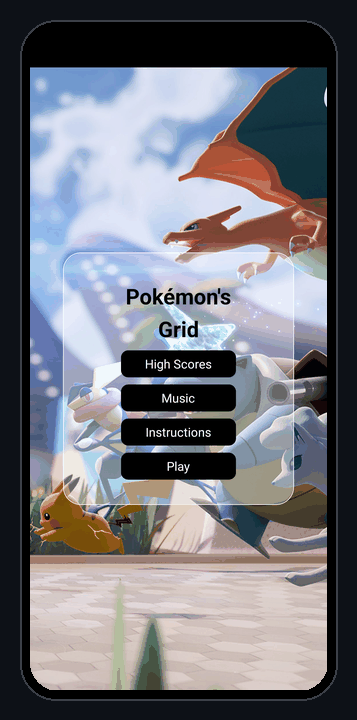
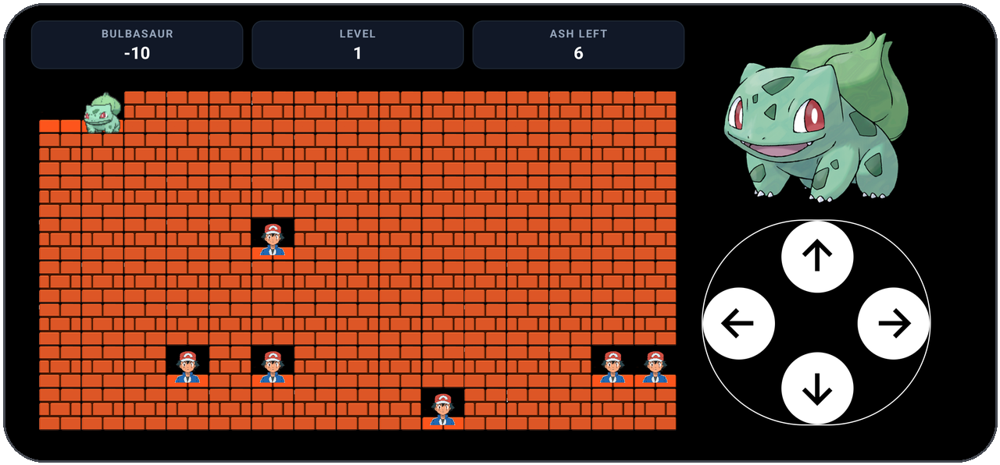

# Pokémon's Grid 🎮

A grid exploration game inspired by the classic *Hunt the Wumpus*, themed with Pokémon fetched live from the
[PokéAPI](https://pokeapi.co/). Built with **React Native** and **TypeScript**; playable in portrait and
landscape.


**[⬇ Download the Android APK](https://github.com/CuencaOscar/Pokemon-s-Grid/releases/latest)** (v1.1.0)

<p align="center"></p>

## How to play

Your Pokémon starts in the top-left corner of a board of hidden cells. Every move costs 10 points and reaching one
of the six visible Ash cells earns 100. Team Rocket and Poké Balls are hidden: stepping on either ends the game,
but the cells next to them show a warning, as in *Hunt the Wumpus*. Catch all six Ash to clear the level.

## Features

- Character selection with Pokémon names and static/animated sprites from the PokéAPI (Axios).
- Grid board with hidden cells, scoring, lives and levels.
- Responsive layout that adapts to portrait and landscape (`useWindowDimensions`).
- Game logic isolated in custom hooks (`useBoardLogicGameScreen`, `usePokemon`, `usePokemonSelector`).
- Stack navigation and fade-in image animations.

## Landscape mode

<p align="center"></p>

## Getting started

Requirements: Node.js and the [React Native environment](https://reactnative.dev/docs/set-up-your-environment).

```bash
yarn install
yarn android       # or: yarn ios
yarn tsc --noEmit && yarn test
```

## Project structure

```
src/
├── api/           # PokéAPI client
├── components/    # Board, cards, buttons, score
├── hooks/         # Game logic and data fetching
├── interfaces/    # API types
├── navigator/     # Stack navigator
└── screens/       # Home, character selection, game
```

## License

Pokémon names, sprites and artwork belong to Nintendo / The Pokémon Company and are not covered by this license.

[MIT](LICENSE) © Oscar Cuenca · [LinkedIn](https://www.linkedin.com/in/ocuenca-moreno/)
