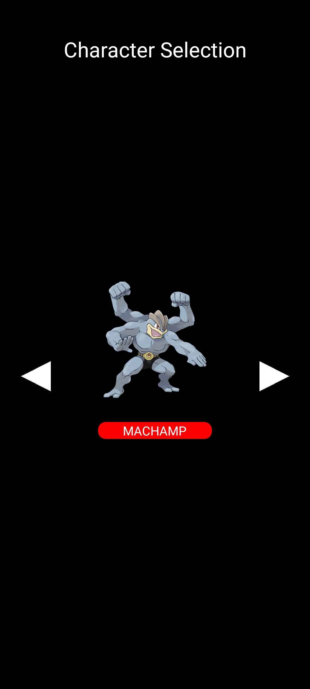
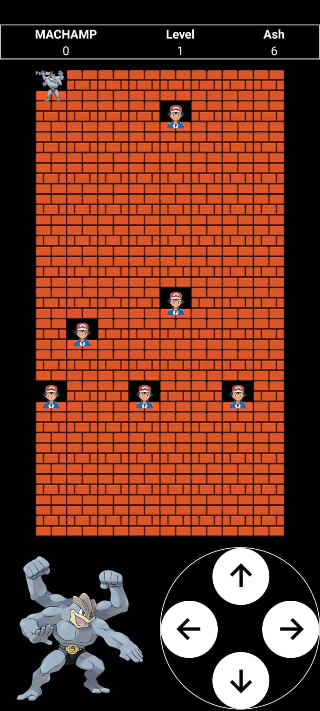

# Pokémon's Grid 🎮

A grid exploration game inspired by the classic *Hunt the Wumpus*, themed with Pokémon fetched live from the
[PokéAPI](https://pokeapi.co/). Built with **React Native** and **TypeScript**; playable in portrait and
landscape.


<p align="center">
  
  
  
</p>

## Features

- Character selection with Pokémon names and static/animated sprites from the PokéAPI (Axios).
- Grid board with hidden cells, scoring, lives and levels.
- Responsive layout that adapts to portrait and landscape (`useWindowDimensions`).
- Game logic isolated in custom hooks (`useBoardLogicGameScreen`, `usePokemon`, `usePokemonSelector`).
- Stack navigation and fade-in image animations.

## Getting started

Requirements: Node.js and the [React Native environment](https://reactnative.dev/docs/set-up-your-environment).

```bash
yarn install
yarn android       # or: yarn ios
```

## Project structure

```
src/
├── api/           # PokéAPI client
├── components/    # Board, cards, buttons, score
├── hooks/         # Game logic and data fetching
├── interfaces/    # API types
├── navigator/     # Stack navigator
└── screens/       # Home, character selection, game
```

---

Pokémon and Pokémon character names are trademarks of Nintendo; this is a non-commercial learning project.

**Oscar Cuenca** · [LinkedIn](https://www.linkedin.com/in/ocuenca-moreno/)
